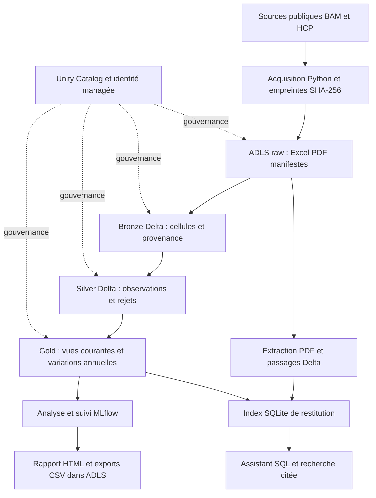

# Radar macro-financier marocain

Pipeline de données économiques sur **Azure Databricks et ADLS Gen2**, de l’archivage des sources BAM/HCP jusqu’à un tableau de bord et un assistant de consultation avec citations.

Ce portfolio démontre une ingestion traçable et idempotente, la gouvernance des tables avec Unity Catalog et la séparation entre données brutes, observations normalisées et vues analytiques.

## Sommaire

- [Fonctionnalités et état réel](#fonctionnalités-et-état-réel)
- [Architecture](#architecture)
- [Organisation du dépôt](#organisation-du-dépôt)
- [Démarrage local](#démarrage-local)
- [Exécution sur Azure](#exécution-sur-azure)
- [Qualité et validation](#qualité-et-validation)
- [Limites et prochaines étapes](#limites-et-prochaines-étapes)
- [Documentation](#documentation)
- [Sources et droits](#sources-et-droits)

## Fonctionnalités et état réel

| Fonction | Réalisation | Validation |
|---|---|---|
| Acquisition BAM/HCP | Téléchargement, archives versionnées par SHA-256, manifestes | Sources publiques consultées |
| Lakehouse | Bronze/Silver en Delta, vues Gold, contrôles et rejets | Exécution Azure réussie |
| Idempotence | MERGE sur identifiants stables et comparaison avant/après | Relance Azure sans doublons ni modification du contenu |
| Analyse | Indicateurs, rapport HTML, trois références statistiques, suivi MLflow | Exécution Azure réussie |
| Assistant | SQL paramétré en lecture seule et recherche PDF FTS5/BM25 | Exécution Azure et scénarios fonctionnels réussis |
| Actualisation | Détection de changements, état persistant, soumission conditionnelle, reprise explicite | Tests locaux et vérification publique sans changement |

**Résultats du snapshot validé en novembre 2026 :** 29 151 observations (4 455 BAM, 24 696 HCP), zéro rejet ; 1 008 passages issus de deux PDF. Les onze scénarios de l’assistant sont des tests fonctionnels, pas une mesure indépendante de pertinence.

Le contrôleur d’actualisation n’est pas planifié. Sa chaîne complète sur Azure avec une publication réellement nouvelle reste à valider. Aucun LLM génératif ni score de risque sectoriel n’est présenté comme réalisé.

## Architecture



Les notebooks Databricks réalisent les traitements ; ADLS conserve les fichiers et les tables. Unity Catalog conserve les métadonnées et permissions. Les vues Gold ne sont pas une copie supplémentaire des observations. L’assistant de démonstration utilise un index exporté localement.

**Stack :** Python, PySpark, SQL, Azure Databricks, ADLS Gen2, Delta Lake, Unity Catalog, MLflow, Plotly, SQLite FTS5, PowerShell et Azure CLI. L’infrastructure est décrite en templates ARM JSON, pas en Terraform.

## Organisation du dépôt

```text
.github/workflows/     Tests automatiques sur push et pull request
config/                Sources, règles d’évaluation et exemple de configuration
infra/                 Templates ARM et paramètres des runs Databricks
notebooks/             Ingestion, analyse et assistant exécutés sur Databricks
radar/                 Modules Python réutilisables localement et dans les notebooks
scripts/               Commandes PowerShell de déploiement et d’exploitation
sql/                   Initialisation SQL
tests/                Tests unitaires et tests sur données locales si disponibles
docs/                 Architecture, guides, résultats et préparation à l’entretien
```

Les répertoires `data/`, `outputs/`, `output/` et `docs/private/` restent **locaux et ignorés par Git**. Ils contiennent respectivement les archives et bases, les résultats générés et les journaux historiques. Les fichiers `config/*.local.json` ne sont jamais destinés à GitHub.

## Démarrage local

Prérequis : **Python 3.12**. PowerShell est utilisé pour les scripts Azure et le téléchargement des PDF. L’exécution des tests unitaires ne nécessite aucun compte cloud.

```bash
python -m venv .venv
```

Activation sous Windows PowerShell :

```powershell
.\.venv\Scripts\Activate.ps1
```

Activation sous Linux ou macOS :

```bash
source .venv/bin/activate
```

Installation et tests :

```bash
python -m pip install -r requirements-dev.txt
python -m unittest discover -s tests -v
```

Les tests nécessitant des archives ou un index local sont ignorés lorsque ces fichiers sont absents. Les tests de référence historiques peuvent échouer après une correction officielle de source : examiner les écarts avant de modifier les attentes.

### Ingestion et rapport

```bash
python -m radar.pipeline --fetch
python -m radar.analytics
```

La première commande accède aux sources publiques et crée `data/`. La seconde génère notamment `outputs/partie-3/radar.html`. Sans `--fetch`, l’ingestion réutilise les archives déjà présentes.

### Assistant documentaire

```powershell
./scripts/download-pdfs.ps1
python -m radar.assistant --build
python -m radar.assistant --interactive
```

Exemples de questions prises en charge :

- « Quel est le crédit bancaire total en août 2026 ? »
- « Recherche documentaire : politique monétaire »
- « Quel est le crédit bancaire total en août 2099 ? » — abstention attendue sur le snapshot actuel.

L’assistant reconnaît des formulations encadrées ; ce n’est pas un moteur de questions SQL arbitraires.

## Exécution sur Azure

Le [guide de déploiement](docs/deployment.md) décrit les prérequis, les ressources et l’ordre d’exécution. Les commandes cloud peuvent entraîner des frais ; aucune commande du démarrage local ne crée de ressources Azure.

```powershell
Copy-Item config/deployment.example.json config/deployment.local.json
# Renseigner les paramètres de votre propre déploiement dans le fichier local.
```

Les scripts lisent ce fichier pour cibler explicitement l’abonnement et le workspace. Ne pas copier les preuves de déploiement historiques comme paramètres d’un nouvel environnement.

### Détection et traitement des mises à jour

```powershell
./scripts/check-updates.ps1              # Consultation publique, sans calcul Azure
./scripts/check-updates.ps1 -Apply       # Upload et run seulement si nécessaire
./scripts/check-updates.ps1 -Apply       # Suivi du même run, sans nouvelle soumission
./scripts/check-updates.ps1 -Apply -Retry # Nouvelle tentative après diagnostic d’échec
```

Les détails et limites figurent dans le [guide d’actualisation](docs/actualisation-incrementale.md). Le contrôleur conserve son état dans `data/refresh/`. Sans baseline locale, un nouveau clone démarre sans supposer que les données historiques ont déjà été ingérées dans son workspace.

## Qualité et validation

- Validation de la structure des fichiers, des dates, valeurs et dimensions.
- Conservation des rejets avec leur motif et de la provenance de chaque observation.
- MERGE avec clés stables pour éviter les réinsertions des mêmes versions.
- Comparaison des effectifs, clés et empreintes du contenu sur une relance réelle.
- Tests de reprise : transfert interrompu, réponse de soumission perdue, run échoué et source revenue à une ancienne version.

Les [preuves de validation](docs/README.md#preuves-de-validation) sont des résultats historiques dont les adresses de déploiement ont été anonymisées. La CI exécute les tests hors cloud ; elle ne valide pas un déploiement Azure et ne lance aucun calcul payant.

## Limites et prochaines étapes

- Pas de planification périodique active ni d’alerte opérationnelle complète.
- Coûts Azure réellement facturés encore à vérifier ; l’enveloppe de 50 USD est un objectif de portfolio, pas une garantie.
- Contrôleur local sur un seul hôte ; pas de verrou distribué ni de transaction globale entre toutes les tables.
- Sources configurées seulement : aucun parcours automatique de tous les jeux BAM/HCP.
- CNSS, correspondances entre branches et scoring sectoriel non intégrés.
- Recherche PDF sans LLM ; pages nécessitant revue et pertinence indépendante encore à évaluer.
- Séries révisées, dates historiques de publication inconnues : les prévisions ne démontrent pas une performance en temps réel.
- Stockage LRS et accès public authentifié : aucune isolation réseau privée ni reprise après sinistre complète.

## Documentation

| Besoin | Document |
|---|---|
| Parcourir les guides et preuves | [Index documentaire](docs/README.md) |
| Comprendre les choix | [Architecture](docs/architecture.md) |
| Déployer sur Azure | [Déploiement](docs/deployment.md) |
| Actualiser les données | [Actualisation](docs/actualisation-incrementale.md) |
| Vérifier l’idempotence | [Test d’idempotence](docs/idempotence.md) |
| Préparer une présentation | [Démonstration de cinq minutes](docs/presentation-5-minutes.md) |
| Préparer le premier push | [Publication GitHub](docs/github.md) |

## Sources et droits

Les références sont conservées dans [config/ingestion.json](config/ingestion.json) et [config/sources.json](config/sources.json). L’ingestion vérifie la licence déclarée par le portail pour les deux ressources structurées. Les conditions de réutilisation des rapports PDF ne sont pas entièrement vérifiées : les fichiers sources ne sont pas redistribués dans ce dépôt.

Aucune licence de réutilisation du code n’a encore été choisie. Ne pas assimiler la visibilité publique du dépôt à une licence open source. Voir [NOTICE.md](NOTICE.md).
