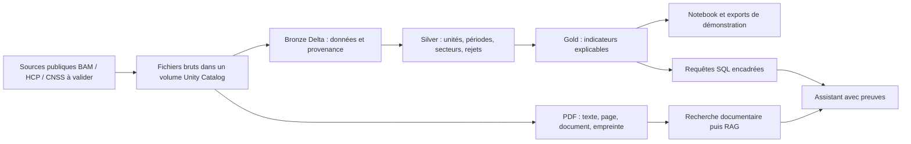

# Architecture et décisions

## Verdict

Architecture Lakehouse pertinente pour démontrer ingestion, qualité, Delta, SQL, gouvernance et recherche sur PDF. Spark est choisi pour l'objectif pédagogique Databricks ; les volumes du MVP ne justifient pas, à eux seuls, un cluster distribué. Le ML supervisé et l'agent hybride restent conditionnels à la qualité des données et au budget.

## Choix retenus

| Décision | Justification en entretien |
|---|---|
| Workspace Azure Databricks serverless en priorité, si éligible | Usage intermittent ; éviter la gestion et les coûts fixes du réseau classique. Comparer le coût total, pas seulement le prix du calcul. |
| Unity Catalog + ADLS Gen2 dans l'abonnement utilisateur | Conserver les données métier dans un stockage contrôlé par le propriétaire ; démontrer identité managée, droits RBAC et gouvernance des tables. Standard LRS/Hot pour ce petit MVP. |
| Un seul environnement de développement | Budget de portfolio ; isoler les couches par schéma et versionner les transformations. |
| Jobs manuels batch | Les publications ne nécessitent pas de streaming. Pas de planification automatique tant que le coût n'est pas mesuré. |
| Delta Bronze/Silver/Gold | Historique des sources, contrôle qualité et tables analytiques reproductibles. |
| Pas de Data Factory, Event Hubs, AKS ni service vectoriel permanent au MVP | Aucun besoin démontré correspondant ; chaque service supplémentaire doit apporter une fonction mesurable. |
| PDF textuels d'abord ; recherche locale au stade initial | Évaluer la récupération et les citations avant de payer un LLM ou un OCR. |
| Exports HTML/CSV et notebook pour la démonstration | Présenter le travail sans laisser un warehouse ou une application démarrés. |

ADLS Gen2 est désormais requis par le propriétaire. Le compte `<storage-account>` contient `raw` (sources) et `lakehouse` (tables Delta). Unity Catalog utilise une identité managée via `ac-radar-macro-dev`. Le catalogue cible `radar_adls` dispose de son stockage géré dans ADLS ; son volume de sources est externe. Le metastore conserve les métadonnées et les permissions dans Databricks. Le stockage interne du workspace serverless reste géré par Databricks. Aucun secret dans Git ; authentification Entra/CLI, permissions limitées aux ressources du projet. Les notifications de fichiers sont désactivées : ingestion manuelle, sans Event Grid ni queues.

## Contrat des données

Une observation conserve : source, identifiant d'indicateur, période, fréquence, secteur et nomenclature, unité, valeur, date de publication si connue, date de collecte, URL, empreinte SHA-256 du fichier, version de transformation. Ne jamais remplacer la date de publication inconnue par la date de collecte.

Conserver les versions des fichiers en Bronze. La clé de version comprend la source, l'indicateur, la période, le secteur, l'unité et l'empreinte source ; définir explicitement la règle de sélection de la version courante en Silver. Une relance du même fichier doit être idempotente.

Ne pas joindre directement une série mensuelle et une série annuelle. Distinguer stocks (fin de période), flux (somme) et taux/indices (agrégation documentée). Ne pas propager rétrospectivement une publication : toute validation temporelle utilise uniquement l'information disponible à la date simulée.

CNSS : disponibilité, granularité sectorielle, période et droits de réutilisation restent à confirmer. Si seules des données agrégées annuelles sont disponibles, les utiliser comme contexte annuel ; ne pas inventer un signal mensuel. Le MVP peut avancer avec BAM/HCP.

## Validation attendue

- Sources : licence ou conditions de réutilisation, téléchargement, format, couverture, fréquence, unités.
- Qualité : doublons, valeurs absentes, dates invalides, unités contradictoires, secteurs non appariés ; quarantaine avec motif.
- Analytique : baseline simple, découpage temporel, absence de fuite de données ; pas de probabilité de défaut sans labels.
- Assistant : citations document/page, questions sans réponse, précision de récupération ; identifiant SQL en liste autorisée, accès lecture seule, limite de lignes et délai d'exécution. Un simple filtre du mot SELECT ne sécurise pas du SQL généré.

## Références vérifiées

- Workspaces serverless : https://learn.microsoft.com/en-us/azure/databricks/admin/workspace/serverless-workspaces
- Limites serverless : https://learn.microsoft.com/en-us/azure/databricks/compute/serverless/limitations
- Coût NAT du réseau classique managé : https://learn.microsoft.com/en-us/azure/databricks/security/network/classic/secure-cluster-connectivity
- Prix Azure Databricks et retrait annoncé de Standard au 1 octobre 2026 : https://azure.microsoft.com/en-us/pricing/details/databricks/
- Gouvernance : https://learn.microsoft.com/en-us/azure/databricks/data-governance/unity-catalog/
